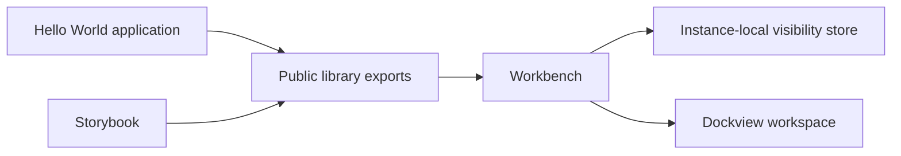

# Architecture

`src/` is the reusable library. `demo/` consumes its public API and contains application-specific content. The library must not import the demo.

Vite builds the ESM package into `dist/`. TypeScript emits declarations there independently. The demo build consumes the built package and writes to `demo-dist/`. In development, Vite resolves the demo's library imports to source for hot reload while a separate Vite build watcher and TypeScript watcher keep package outputs current. Both watchers and the demo server run in one Node process and close on Ctrl+C.

The Hello World module lives in the demo's `src/plugins/hello-world/` directory and is imported explicitly for this increment. Plugin discovery and the SDK belong to Feature 9.

Storybook and Vitest run independently of the demo. Distribution includes only library artifacts, documentation, and license notices.

Each workbench owns a separate Zustand visibility store. Focus mode suppresses chrome without changing header/footer preferences or unmounting Dockview. Focus returns to the trigger when leaving focus mode. Escape handling is scoped to the workbench; there is no global command registry in this increment.

Panel definitions are validated before Dockview receives them. Application components are passed through stable renderers, and Dockview's `always` renderer retains inactive panel state. There is no saved-layout persistence yet. The demo uses only the MIT edition's docking features.
