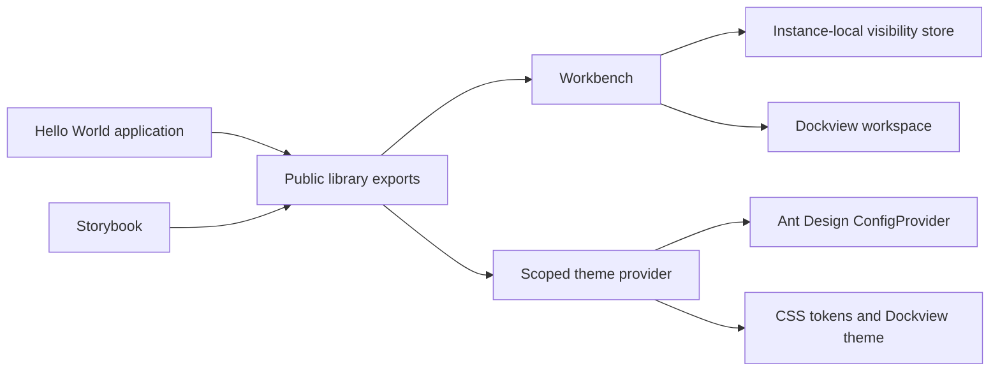

# Architecture

`src/` is the reusable library. `demo/` consumes its public API and contains application-specific content. The library must not import the demo.

Vite builds the ESM package into `dist/`. TypeScript emits declarations there independently. The demo build consumes the built package and writes to `demo-dist/`. In development, Vite resolves the demo's library imports to source for hot reload while a separate Vite build watcher and TypeScript watcher keep package outputs current. Both watchers and the demo server run in one Node process and close on Ctrl+C.

The demo discovers `src/plugins/*/index.ts` with Vite's eager `import.meta.glob`. `registerLocalPlugins` activates default exports in path order. The registry rolls back failed activations and freezes its six contribution collections when Workbench mounts. Plugins are trusted application code bundled at build time; no remote loading or runtime filesystem scanning occurs. Adding/removing a plugin requires restarting the mounted workbench; the demo's HMR boundary reloads on plugin module changes.

Plugin panels precede application panels, which may position themselves relative to a plugin panel. Commands are connected to the existing command/notification providers; menus invoke command IDs, and status/monitoring components render inside those same providers. The SDK model does not import the workbench UI. Runtime command conflicts report one notification and remove the attempted plugin-command batch, leaving panels usable. Plugin activation itself must be synchronous.

Storybook and Vitest run independently of the demo. Distribution includes only library artifacts, documentation, and license notices.

Each workbench owns a separate Zustand visibility store. Focus mode suppresses chrome without changing header/footer preferences or unmounting Dockview. Focus returns to the trigger when leaving focus mode. Keyboard dispatch, including Escape, is scoped to the focused workbench.

Panel definitions are validated before Dockview receives them. Application components are passed through stable renderers, and Dockview's `always` renderer retains inactive panel state. The demo uses only the MIT edition's docking features.

Each stable panel renderer includes its own full-height scroll container. Overflow scrolls within that panel, and tab changes retain its scroll position. View toggles header and footer together; individual visibility preferences and existing commands remain available.

Layout management captures the initial native Dockview layout before loading a saved checkpoint. Versioned checkpoints contain the native layout and header/footer preferences. Loading validates panel identities, components, group membership, and grid structure before calling `fromJSON` with `reuseExistingPanels`. Explicit saves persist per application; a failed browser write keeps an in-memory checkpoint. Reset and presets reuse existing panels, and do not replace the saved checkpoint. Popout browser windows are not restored.

ThemeProvider owns another instance-local Zustand store. A single palette supplies CSS tokens and Ant Design tokens; Dockview keeps its native light/dark theme with CSS-variable overrides. A workbench inherits the nearest provider or creates a light provider automatically. Native controls and popup containers follow the local color scheme. Theme changes never recreate the workspace or its panels. The workbench configuration integration persists preferences separately from layout checkpoints.

Reduced-motion preferences are observed with a media query, including changes during a session. CSS transitions and Ant Design motion durations become zero. Ant Design's boolean motion flag stays stable because changing it can insert provider wrappers and remount the application subtree. Contrast tests independently compute luminance for primary, secondary, and primary-button text in both palettes.

NotificationProvider owns a bounded Zustand history, unread flags, and the active toast IDs. Dismissing a toast never removes or acknowledges its history entry. Toast components own and clean up their timers. A native modal dialog supplies keyboard focus containment and Escape handling for the history. Layout feedback is published once per action into the same center; the library does not have a second feedback system. Each workbench creates a provider unless an application supplies one.

CommandRegistry is independent of React and browser globals. It stores action definitions, checks canonical shortcut conflicts, blocks overlapping runs of the same registration, and provides disposable registrations and external-store snapshots. React's CommandProvider adapts it to notification error feedback. The workbench integration registers built-in actions over the existing theme, visibility, notification, and layout operations, and handles keyboard events at the workbench boundary. No lower-level service imports Workbench. Application actions follow the same lifecycle, demonstrated by the Playground commands.

CommandPalette consumes that registry without duplicating actions. A pure search function ranks title/ID matches and recent successful selections. The controlled native dialog keeps focus in a combobox, exposes a listbox with its active descendant, skips unavailable commands during keyboard navigation, and closes before executing an action that may open another dialog. Recent selections are local session state.

The Ant Design hamburger menu invokes registered commands to open Settings, Preferences, or the configuration file controls. The native settings dialog reuses the existing visibility and layout operations. Preferences keeps a draft until Apply. Theme and notification stores own their respective choices; neither imports the settings UI or the workbench.

Shared overlay styles animate native dialogs from outside the viewport, fade their backdrops, and slide notifications from the right. System and explicit reduced-motion preferences disable these effects. A shared pointer handler dismisses native dialogs only when a primary click starts and ends on the backdrop, preserving drags that begin in their content. Native dialog focus restoration and Escape handling remain in place.

The pure configuration decoder validates the complete versioned JSON file before the workbench applies it. Native layout restoration reuses panels and rolls back a Dockview failure. Imports then apply validated preferences and explicitly save a layout checkpoint. Storage writes to the layout and preference keys are independent; if either fails, the imported configuration stays usable in memory and notification feedback states that persistence was incomplete. Export reads the live layout without changing the saved checkpoint. Data stays in the browser and local JSON files.
